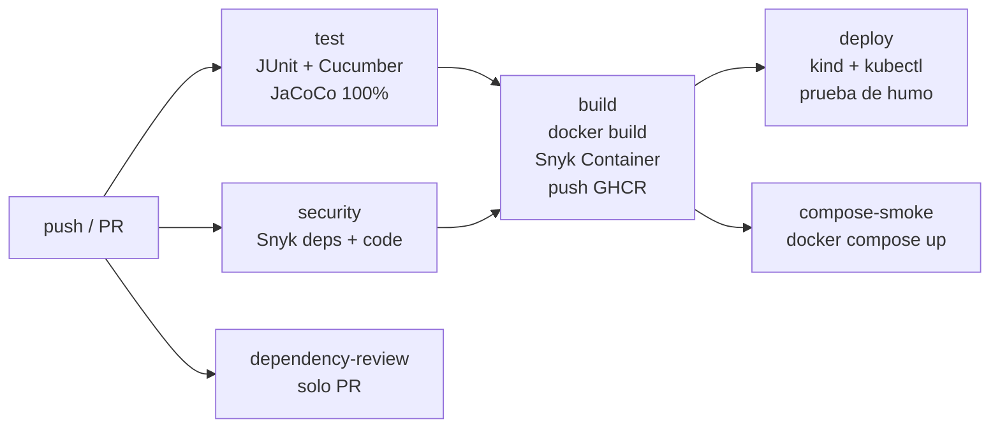

# Contratos — Pipeline CI/CD (Evaluación Parcial N°2 · DOY0101)

**Autor:** Matías Orostica

Microservicio **contratos-svc** del caso caso11 — InmoNube, con su ciclo de vida automatizado en GitHub Actions: pruebas, análisis de seguridad, contenedores, despliegue y orquestación.

| | |
|---|---|
| Stack | Spring Boot 4.1 · Java 21 · Maven · Spring Data JPA · H2 · springdoc-openapi · Actuator |
| Calidad | JUnit 5 + Mockito · Cucumber (BDD) · JaCoCo con cobertura LINE mínima de 100% |
| Seguridad | Dependabot · Snyk Open Source · Snyk Code · Snyk Container · Dependency Review |
| Contenedores | Docker multi-etapa · GHCR · Docker Compose · Kubernetes (kind) |

## Cómo cumple cada punto del encargo

| # | Requisito | Dónde está | IE |
|---|---|---|---|
| 1 | Dockerfile para contenerizar el microservicio | [`Dockerfile`](Dockerfile) | IE1 |
| 2a | Construcción de imagen Docker en el pipeline | job `build` en [`ci-cd.yml`](.github/workflows/ci-cd.yml) | IE1 |
| 2b | Pruebas unitarias (JUnit + Cucumber) | job `test` | IE2 |
| 2c | Dependabot + análisis con Snyk | [`dependabot.yml`](.github/dependabot.yml), job `security` | IE3 |
| 2d | Despliegue automático en entorno simulado | jobs `deploy` (Kubernetes kind) y `compose-smoke` | IE4 |
| 3 | Bloqueos y alertas si la seguridad falla | `--severity-threshold=high`, `needs:`, SARIF en *Security* | IE3 |
| 4 | Orquestación con Kubernetes y Docker Compose | [`k8s/`](k8s/), [`docker-compose.yml`](docker-compose.yml) | IE5 |
| 5 | Documentación, trazabilidad y calidad | este README | IE4 |

## 1. Contenedor (IE1)

El [`Dockerfile`](Dockerfile) tiene dos etapas:

1. **build** (`maven:3.9-eclipse-temurin-21-alpine`): descarga dependencias con caché de BuildKit, compila el JAR y lo separa en las capas de Spring Boot (`dependencies`, `spring-boot-loader`, `snapshot-dependencies`, `application`).
2. **runtime** (`eclipse-temurin:21-jre-alpine`): solo lleva el JRE y las capas. No incluye Maven ni el código fuente.

Decisiones:

- **Imagen optimizada:** JRE en Alpine. Como las dependencias van en su propia capa, cuando solo cambia el código se reconstruye y se sube únicamente la capa `application`.
- **Usuario sin privilegios** (`uid 10001`): el contenedor no corre como root.
- **`HEALTHCHECK`** contra `/actuator/health/readiness`.
- **JVM consciente del contenedor:** `-XX:MaxRAMPercentage=75` ajusta el heap al límite de memoria que se le dé al contenedor.
- **Etiquetas OCI** con el commit (`org.opencontainers.image.revision`) y la fecha de build, para trazabilidad.
- **Perfil `prod`** ([`application-prod.yml`](src/main/resources/application-prod.yml)): deshabilita la consola H2 y solo expone `health` e `info` de Actuator.

## 2. Pipeline CI/CD

Archivo: [`.github/workflows/ci-cd.yml`](.github/workflows/ci-cd.yml). Se ejecuta en `push` a `main` y `develop`, en pull requests hacia ambas ramas y de forma manual.



| Job | Qué hace | Si falla |
|---|---|---|
| `test` | `mvn verify`: pruebas JUnit/Mockito, escenarios Cucumber y check de JaCoCo (cobertura LINE ≥ 100%). Publica los reportes como artefacto y un resumen en la ejecución. | No se construye la imagen |
| `security` | Snyk Open Source (dependencias Maven) y Snyk Code (SAST). Sube los hallazgos en SARIF a *Security → Code scanning*. | No se construye la imagen |
| `dependency-review` | En PRs, bloquea si se agrega una dependencia con vulnerabilidades altas. | El PR queda bloqueado |
| `build` | Construye la imagen, la escanea con Snyk Container y, si pasa, la publica en `ghcr.io/<owner>/contratos-svc`. | No se despliega |
| `deploy` | Crea un cluster Kubernetes efímero con **kind**, aplica `k8s/`, fija la imagen del commit, espera el rollout y hace una prueba de humo (health, POST, GET, info). | El despliegue se marca como fallido y se imprimen logs y `describe` de los pods |
| `compose-smoke` | Levanta la misma imagen con Docker Compose y espera a que quede `healthy`. | — |

### Pruebas automatizadas (IE2)

| Suite | Tipo | Qué cubre |
|---|---|---|
| `ContratoServiceTest` | Unitaria (Mockito) | Lógica de negocio: crear, listar, buscar, actualizar y eliminar, incluidos los casos de id inexistente |
| `ContratoControllerTest` | Unitaria de capa web (MockMvc) | Códigos HTTP 200/201/204/404 y validación (400 si falta `nombre`) |
| `OpenApiConfigTest` | Unitaria | Configuración de la documentación OpenAPI |
| `CucumberRunnerTest` | BDD | Escenarios de [`contratos.feature`](src/test/resources/cucumber/contratos.feature) sobre los endpoints REST |

**Política de calidad:** el build falla si una sola prueba falla o si la cobertura de líneas baja del 100% (regla `jacoco:check` en el [`pom.xml`](pom.xml)). Al estar en `mvn verify`, la regla corre en cada push y en cada PR.

## 3. Seguridad, bloqueos y alertas (IE3)

| Control | Herramienta | Umbral | Efecto |
|---|---|---|---|
| Actualización de dependencias | **Dependabot** (Maven, imágenes Docker, Actions) | semanal | Abre PRs hacia `develop`, que pasan por todo el pipeline |
| Vulnerabilidades en dependencias | **Snyk Open Source** | `high` | El job falla y bloquea `build` y `deploy` |
| Vulnerabilidades en el código | **Snyk Code** | `high` | El job falla y bloquea `build` y `deploy` |
| Vulnerabilidades en la imagen | **Snyk Container** | `high` | La imagen no se publica ni se despliega |
| Dependencias nuevas en un PR | **Dependency Review** | `high` | El PR no se puede fusionar |
| Alertas | SARIF en *Security → Code scanning* y resumen en cada ejecución | — | Visibles para todo el equipo |

El bloqueo se basa en las dependencias entre jobs (`needs: [test, security]`): si `security` falla, `build` y `deploy` no se ejecutan. Para que un PR tampoco se pueda fusionar, se configura **branch protection** (ver *Configuración inicial*).

En el despliegue también se aplican controles: el namespace exige `pod-security.kubernetes.io/enforce: restricted`, y los pods corren sin root, con `readOnlyRootFilesystem`, sin capabilities, con `seccomp RuntimeDefault` y sin token de ServiceAccount. En Compose se usan `read_only`, `cap_drop: ALL` y `no-new-privileges`.

## 4. Orquestación (IE5) y escalabilidad (IE3)

Manifiestos en [`k8s/`](k8s/):

| Archivo | Recurso | Propósito |
|---|---|---|
| `namespace.yaml` | Namespace `contratos` | Aislamiento y Pod Security *restricted* |
| `configmap.yaml` | ConfigMap | Perfil `prod` y opciones de la JVM, separados de la imagen |
| `deployment.yaml` | Deployment | 2 réplicas, `RollingUpdate` con `maxUnavailable: 0`, *requests/limits*, *probes* startup/liveness/readiness |
| `service.yaml` | Service ClusterIP | Balancea entre las réplicas |
| `hpa.yaml` | HorizontalPodAutoscaler + PodDisruptionBudget | Escala de 2 a 5 réplicas al 70% de CPU y mantiene al menos 1 disponible |

[`docker-compose.yml`](docker-compose.yml) es la alternativa local, con límites de CPU y memoria, healthcheck y endurecimiento.

> **Limitación conocida:** la base de datos es H2 en memoria, así que cada réplica tiene sus propios datos. El escalado horizontal es correcto para la parte sin estado del servicio. En un entorno real habría que mover la persistencia a una base de datos externa (por ejemplo, RDS PostgreSQL, como en la arquitectura AWS de [`docs/`](docs/)).

## 5. Trazabilidad desde el desarrollo hasta producción (IE4)

Cada cambio se puede seguir de punta a punta:

1. **Commit → rama → PR**: GitFlow (`feature/*` → `develop` → `main`) y Conventional Commits.
2. **Commit → ejecución del pipeline**: cada ejecución queda asociada a su SHA, con los reportes de pruebas (`reportes-pruebas-<sha>`) y los hallazgos de seguridad.
3. **Commit → imagen**: la imagen se etiqueta `sha-<7 caracteres>` y lleva la etiqueta OCI `revision=<sha completo>`. El resumen de la ejecución muestra el **digest** publicado.
4. **Imagen → despliegue**: el job `deploy` despliega **exactamente esa imagen** y anota el Deployment con:
   - `app.duoc.cl/git-sha`: commit desplegado
   - `app.duoc.cl/pipeline-run`: URL de la ejecución de Actions
   - `kubernetes.io/change-cause`: aparece en `kubectl rollout history`
5. **Servicio en ejecución → commit**: `GET /actuator/info` devuelve `{"app":{"version":"<sha>"}}`.
6. **Entornos**: `develop` despliega en `desarrollo-simulado` y `main` en `produccion-simulada` (GitHub Environments), con historial de despliegues en la pestaña *Deployments*.

Si hay que revertir: `kubectl -n contratos rollout undo deployment/contratos-svc` (se guardan 5 revisiones), o un revert del commit, que vuelve a pasar por todo el pipeline.

## Configuración inicial del repositorio

1. **Token de Snyk**: crear una cuenta en [snyk.io](https://snyk.io), copiar el token desde *Account settings → Auth Token* y guardarlo en *Settings → Secrets and variables → Actions* como `SNYK_TOKEN`. Para Snyk Code, activarlo en *Snyk → Settings → Snyk Code*.
2. **Dependabot**: en *Settings → Code security*, activar *Dependabot alerts* y *Dependabot security updates*.
3. **Protección de ramas** (`main` y `develop`): *Settings → Branches → Add rule*. Marcar *Require a pull request* y *Require status checks to pass*, y seleccionar `Pruebas unitarias y cobertura`, `Analisis de seguridad (Snyk)` y `Revision de dependencias del PR`.
4. **Paquete GHCR**: después del primer push a `main`, el paquete `contratos-svc` aparece en el perfil. Se puede dejar público en *Package settings*.

## Ejecución local

```bash
mvn spring-boot:run                 # http://localhost:8080
mvn verify                          # pruebas + cobertura JaCoCo
docker compose up --build           # contenedor con perfil prod
```

Con un cluster local (kind, minikube o Docker Desktop):

```bash
docker build -t contratos-svc:local .
kind load docker-image contratos-svc:local    # solo si se usa kind
kubectl apply -f k8s/namespace.yaml && kubectl apply -f k8s/
kubectl -n contratos rollout status deployment/contratos-svc
kubectl -n contratos port-forward svc/contratos-svc 8080:80
```

Endpoints: `/api/contratos` (CRUD), `/swagger-ui/index.html`, `/redoc.html`, `/actuator/health`, `/actuator/info`. Más detalle en [`docs/`](docs/).

## Modelo de ramificación

GitFlow: `main` (producción), `develop` (integración), `feature/*`, `hotfix/*`. Dependabot abre sus PRs hacia `develop`.

## Uso de IA

<!-- Completar/ajustar con lo que realmente se usó. -->
- **Claude (Anthropic), mediante Claude Code:** apoyo en la redacción del Dockerfile, del workflow de GitHub Actions, de la configuración de Dependabot, de los manifiestos de Kubernetes y de la estructura de este README. El equipo revisó y validó el contenido ejecutando las pruebas y el contenedor.
- **Gemini** (Evaluación 1): sintaxis de Git para GitFlow y estructura inicial del workflow.

Las conclusiones y reflexiones personales se escribieron sin apoyo de IA.

## Conclusiones y reflexión personal

<!-- Según las instrucciones de la evaluación, esta sección debe redactarse SIN apoyo de IA. -->

**Matías Orostica:** _pendiente: aprendizaje y aporte al proyecto._
