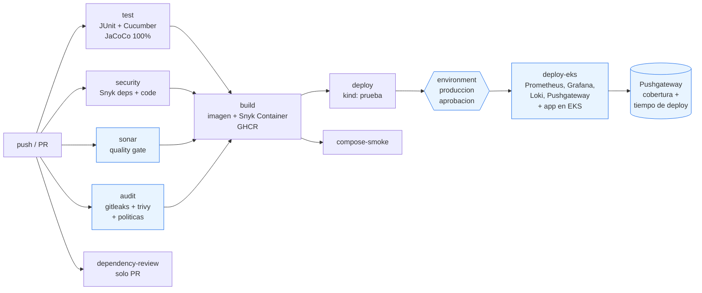

# EP3 — Observabilidad, Kubernetes en la nube y cumplimiento

EP3 se construye **sobre** el pipeline de EP2: no se reemplazó ningún job. Se agregaron gates de cumplimiento (SonarCloud y auditoría propia), el despliegue real en **Amazon EKS** (AWS Academy Learner Lab) y la observabilidad desplegada por el mismo pipeline.

## 1. Mapa del pipeline (EP2 + bloques nuevos)



Workflow aparte: [`infra-eks.yml`](../.github/workflows/infra-eks.yml) crea / elimina el cluster EKS (`k8s/eks/*.sh`). Nadie ejecuta `kubectl apply` ni crea el cluster a mano.

| Carpeta | Contenido |
|---|---|
| [`k8s/`](../k8s/) | Manifiestos de la app (EP2) + [`k8s/eks/`](../k8s/eks/) scripts de creación/eliminación del cluster |
| [`monitoring/`](../monitoring/) | Valores Helm de kube-prometheus-stack, Loki y Pushgateway, ServiceMonitor, reglas de alerta y [dashboard](../monitoring/dashboards/contratos-svc.json) |
| [`audit/`](../audit/) | [`auditoria.sh`](../audit/auditoria.sh) y reglas de secretos [`gitleaks.toml`](../audit/gitleaks.toml) |

## 2. IE1 — Monitoreo: las 4 señales

La app expone métricas propias en `/actuator/prometheus` (Micrometer) y escribe logs JSON (formato ECS) por stdout. **No se monitorea solo el contenedor**: se combinan métricas de la aplicación (HTTP, JVM) con las del cluster (cgroup / kube-state-metrics).

| Señal | Fuente | Dónde se ve | Cómo verificarlo |
|---|---|---|---|
| **Uso** (CPU, memoria) | cAdvisor (cgroup) + `jvm_memory_*` | Grafana › fila *Uso* | `kubectl top pods -n contratos`; Prometheus: `container_cpu_usage_seconds_total{namespace="contratos"}` |
| **Errores** (5xx) | `http_server_requests_seconds_count{status=~"5.."}` | Grafana › *Errores registrados*; alerta `ContratosErrores5xx` | Prometheus › Graph con esa consulta |
| **Disponibilidad** | `up{job="contratos-svc"}`, `kube_deployment_status_replicas_available`, probes | Grafana › *Disponibilidad*; alertas `ContratosCaido`, `ContratosReinicios` | Prometheus › Status › Targets: `contratos-svc` en UP |
| **Logs** | stdout JSON → Promtail → Loki | Grafana › *Logs (Loki)* o Explore › Loki `{namespace="contratos"}` | `kubectl -n contratos logs -l app=contratos-svc` |

Microservicios monitoreados: `contratos-svc` (único microservicio del repositorio). El ServiceMonitor selecciona por la etiqueta `app`, así que cada microservicio nuevo que se despliegue con su Service etiquetado queda monitoreado sin cambiar Prometheus.

Configuración versionada: [`application.yml`](../src/main/resources/application.yml), [`application-prod.yml`](../src/main/resources/application-prod.yml), [`monitoring/servicemonitor.yaml`](../monitoring/servicemonitor.yaml), [`monitoring/alertas.yaml`](../monitoring/alertas.yaml).

## 3. IE2 — Kubernetes en la nube

| Elemento | Valor |
|---|---|
| Nube | AWS Academy Learner Lab — Amazon EKS, `us-east-1` |
| Cluster | `contratos-eks`, nodegroup `nodos` (3 × t3.medium), rol `LabRole` |
| Quién lo crea | workflow *Infraestructura EKS* → [`crear-cluster.sh`](../k8s/eks/crear-cluster.sh) |
| Quién despliega | job `deploy-eks` del pipeline (solo `main`, con aprobación del environment `produccion`) |
| Trazabilidad | anotaciones `app.duoc.cl/git-sha`, `app.duoc.cl/pipeline-run`, `app.duoc.cl/desplegado-por` y `kubectl rollout history` |
| Observabilidad | namespace `monitoring` del **mismo cluster**: Prometheus, Alertmanager, Grafana, Loki + Promtail, Pushgateway (Helm, instalado por el pipeline) |

Acceso a Grafana (la clave la genera el pipeline y queda en un Secret, no en el repo):

```bash
aws eks update-kubeconfig --name contratos-eks --region us-east-1
kubectl -n monitoring get secret grafana-admin -o jsonpath='{.data.admin-password}' | base64 -d; echo
kubectl -n monitoring port-forward svc/kube-prometheus-stack-grafana 3000:80   # http://localhost:3000
```

> **Presupuesto del Learner Lab (50 USD):** el control plane de EKS cobra por hora aunque la sesión esté cerrada. Al terminar de trabajar, ejecutar *Infraestructura EKS › eliminar*; para volver, *crear* y relanzar el pipeline de `main`.
> **Credenciales temporales:** las de AWS Academy duran lo que dura la sesión (4 h). Al iniciar cada sesión hay que actualizar los secretos `AWS_ACCESS_KEY_ID`, `AWS_SECRET_ACCESS_KEY` y `AWS_SESSION_TOKEN` (Learner Lab › AWS Details › Show).

## 4. IE3 — Dashboard con las 4 métricas

Dashboard como código: [`monitoring/dashboards/contratos-svc.json`](../monitoring/dashboards/contratos-svc.json). El pipeline lo publica como ConfigMap con la etiqueta `grafana_dashboard=1` y el sidecar de Grafana lo carga.

| Métrica exigida | Panel | Consulta (resumen) | Origen |
|---|---|---|---|
| CPU / memoria | *CPU usada (% del límite)*, *CPU por pod*, *Memoria por pod*, *Heap JVM* | `container_cpu_usage_seconds_total`, `container_memory_working_set_bytes` | cluster (cgroup) + app |
| Errores registrados | *Errores 5xx (%)*, *Tasa de errores 5xx*, *Respuestas por código* | `http_server_requests_seconds_count{status=~"5.."}` | app (Micrometer) |
| Cobertura de pruebas | *Cobertura de pruebas (JaCoCo)*, *Cobertura por despliegue* | `ci_jacoco_line_coverage_percent` | job `test` → `deploy-eks` → Pushgateway |
| Tiempo de despliegue | *Tiempo de despliegue*, *Duración del despliegue* | `ci_deploy_duration_seconds` | job `deploy-eks` → Pushgateway |

Paneles adicionales: réplicas disponibles, disponibilidad 24 h, latencia p95 y logs (Loki).

## 5. IE4 — Cómo se decide con los datos

> ✍️ **Esta sección la deben escribir los integrantes, sin IA** (la pauta prohíbe IA en justificaciones técnicas y conclusiones). Abajo están los datos de apoyo; lo que falta es el razonamiento propio.

### 5.1 Por qué cada herramienta

| Herramienta | Qué hace en el proyecto | Por qué se eligió (escribir) |
|---|---|---|
| Prometheus + Micrometer | Recolecta métricas de la app y del cluster cada 15 s | ✍️ |
| Grafana | Dashboard versionado con las 4 métricas | ✍️ |
| Loki + Promtail | Centraliza los logs JSON de todas las réplicas | ✍️ |
| Pushgateway | Recibe métricas del pipeline (cobertura, tiempo de deploy) | ✍️ |
| Alertmanager / PrometheusRule | Alertas de caída, 5xx, CPU, heap y reinicios | ✍️ |
| Amazon EKS | Cluster Kubernetes gestionado | ✍️ |
| SonarCloud | Quality gate de calidad y seguridad | ✍️ |
| gitleaks / trivy | Auditoría de secretos y CVE críticas | ✍️ |

### 5.2 Panel → decisión → acción (ejemplos reales del proyecto)

Completar con capturas y datos reales de **su** cluster:

| Panel / alerta | Umbral configurado | Lo que se observó (dato real) | Decisión | Acción tomada |
|---|---|---|---|---|
| CPU usada (% del límite) | 60% naranja · 80% rojo (alerta 10 min) | ✍️ | ✍️ | ✍️ (p. ej. revisar HPA `k8s/hpa.yaml`) |
| Memoria por pod / Heap JVM | límite 512Mi · heap 85% | ✍️ | ✍️ | ✍️ |
| Errores 5xx (%) | 1% naranja · 5% rojo | ✍️ | ✍️ | ✍️ (p. ej. `kubectl rollout undo`) |
| Cobertura de pruebas | gate de JaCoCo en 100% | ✍️ | ✍️ | ✍️ |
| Tiempo de despliegue | 300 s naranja · 600 s rojo | ✍️ | ✍️ | ✍️ |
| Disponibilidad / réplicas | < 2 réplicas naranja | ✍️ | ✍️ | ✍️ |

## 6. IE5 — Cumplimiento en 3 vías

| Política | Herramienta | Verificación (dónde está la evidencia) |
|---|---|---|
| Calidad y seguridad del código sobre el umbral | **SonarCloud quality gate** (job `sonar`, `sonar.qualitygate.wait=true`) | Ejecución en Actions + proyecto en sonarcloud.io |
| Ningún cambio llega a `main` sin PR ni checks en verde | **Branch protection** en `main` (PR obligatorio + status checks requeridos) | *Settings › Branches* (captura) |
| Sin secretos en el repositorio | **gitleaks** con reglas por defecto + regla propia (`audit/gitleaks.toml`) | Job `audit` › reporte en el resumen y artefacto `auditoria-<sha>` |
| Sin CVE críticas con parche disponible | **trivy** (`audit/auditoria.sh`, P2) + Snyk (EP2) | Job `audit` y job `security` |
| Contenedor sin root, con límites y sin `:latest` | **script propio** (`audit/auditoria.sh`, P3–P5) | Job `audit` |
| Producción solo con aprobación | **Environment `produccion`** con revisor requerido | *Settings › Environments* + historial de *Deployments* |

## 7. IE6 — Demostración del freno

1. **Gates secuenciales:** `build` necesita `test`, `security`, `sonar` y `audit`; `deploy-eks` necesita `build` y la prueba en kind. Si cualquiera falla, los siguientes quedan **skipped**.
2. **Producción protegida:** `deploy-eks` usa el environment `produccion`, que exige aprobación manual.
3. **Fallas inyectadas** (ramas que **no** se fusionan):

| Rama | Falla inyectada | Gate que frena | Ejecución (evidencia) |
|---|---|---|---|
| `demo/freno-secreto` | Clave de API falsa en `application-demo.yml` | `audit` (gitleaks, P1) | ✍️ enlace a la ejecución en rojo |
| `demo/freno-cve` | `log4j-core 2.14.1` (CVE-2021-44228, crítica) | `audit` (trivy, P2) y `security` (Snyk) | ✍️ enlace a la ejecución en rojo |

Evidencia esperada en cada ejecución: gate en rojo, `build` / `deploy` / `deploy-eks` en **skipped**, ninguna imagen nueva en GHCR. Capturas en [`docs/evidencias/`](evidencias/).

## 8. Uso de IA (declaración)

> ✍️ Completar según la guía de la biblioteca (bibliotecas.duoc.cl/ia): herramienta, para qué se usó y cómo se validó.

| Herramienta | Uso | Validación |
|---|---|---|
| Claude (Anthropic) | Apoyo en la escritura de configuración: manifiestos, valores Helm, workflows, script de auditoría y dashboard JSON | ✍️ (p. ej. revisión de cada archivo y ejecución del pipeline en verde) |

No se usó IA en: justificaciones técnicas (5.1), decisiones (5.2), conclusiones ni reflexión individual.

## 9. Reflexión individual

> ✍️ Una por integrante, escrita sin IA.

- **Matías Orostica:** ✍️
- **Integrante 2:** ✍️
